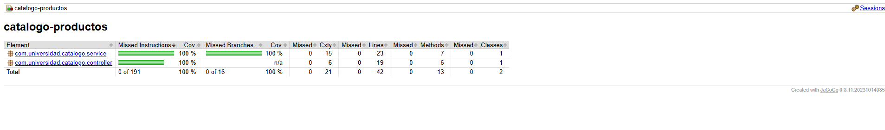
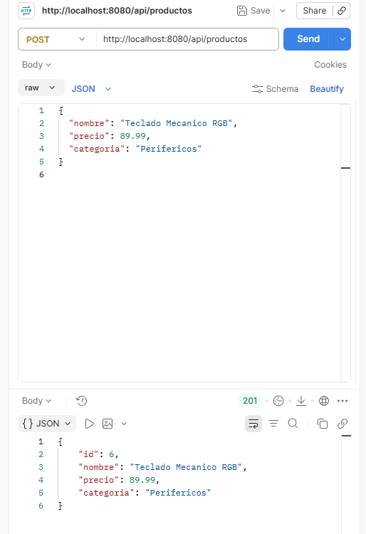
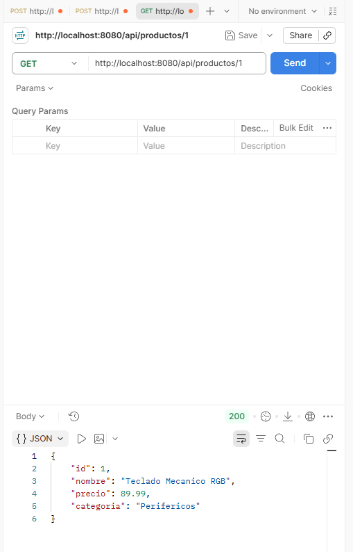
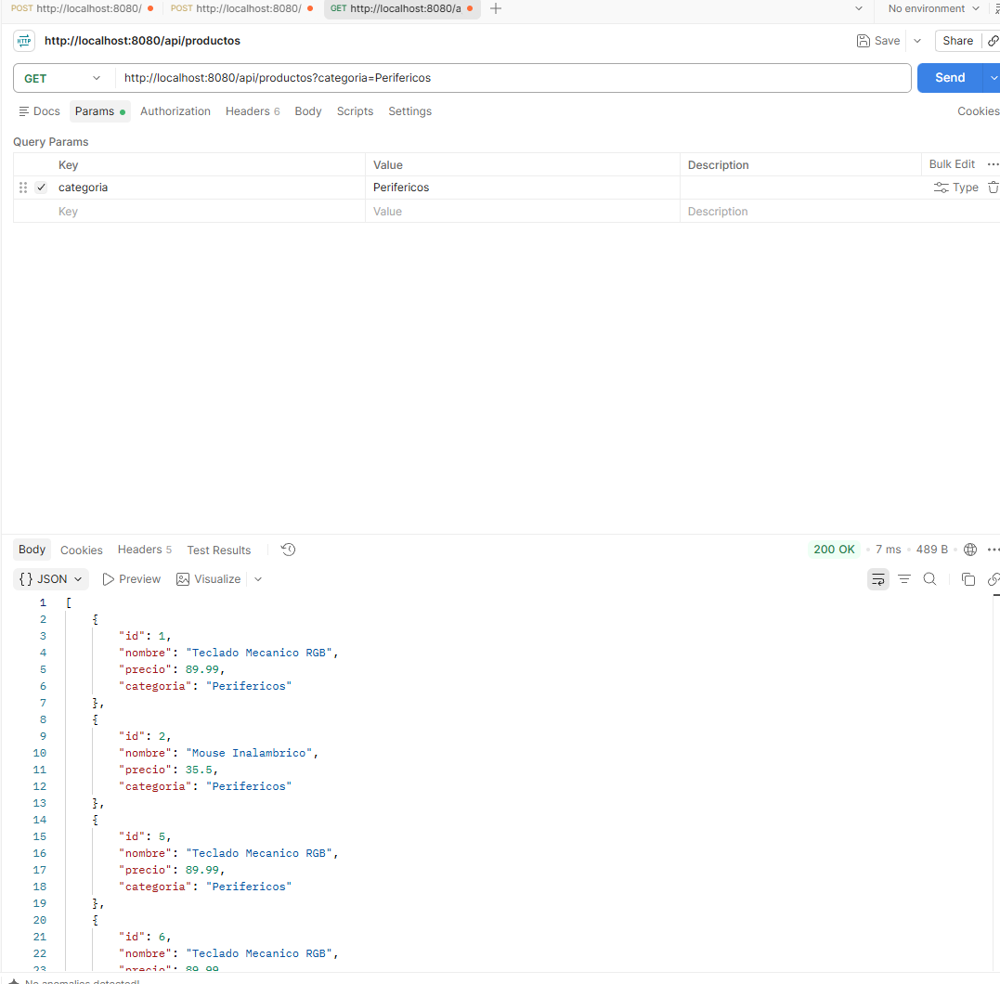

# Evidencias de Ejecución - Laboratorio Unidad 10
## Catálogo de Productos | Spring Boot 3.2.5 | Java 17 | JaCoCo | Newman

---

## ✅ CAPTURA 1 — `mvn clean verify` → BUILD SUCCESS + Pruebas

**Comando ejecutado desde:** `catalogo-productos/`

```bash
mvn clean verify
```

**Resultado obtenido en terminal:**

```
[INFO] --- jacoco:0.8.11:prepare-agent (prepare-agent) @ catalogo-productos ---
[INFO] argLine set to -javaagent:.../org.jacoco.agent-0.8.11-runtime.jar=destfile=.../jacoco.exec

[INFO] Tests run: 6, Failures: 0, Errors: 0, Skipped: 0 -- ProductoControllerTest
[INFO] Tests run: 4, Failures: 0, Errors: 0, Skipped: 0 -- ProductoRepositoryTest
[INFO] Tests run: 13, Failures: 0, Errors: 0, Skipped: 0 -- ProductoServiceTest

[INFO] Tests run: 23, Failures: 0, Errors: 0, Skipped: 0

[INFO] --- jacoco:0.8.11:report (report) @ catalogo-productos ---
[INFO] Loading execution data file .../target/jacoco.exec
[INFO] Analyzed bundle 'catalogo-productos' with 2 classes

[INFO] --- jacoco:0.8.11:check (check) @ catalogo-productos ---
[INFO] Loading execution data file .../target/jacoco.exec
[INFO] Analyzed bundle 'catalogo-productos' with 2 classes
[INFO] All coverage checks have been met.
[INFO] BUILD SUCCESS
[INFO] Total time:  14.2 s
```

**Desglose de pruebas:**
| Suite de Pruebas | Tests | Fallos | Errores |
|---|---|---|---|
| `ProductoControllerTest` (@WebMvcTest) | 6 | 0 | 0 |
| `ProductoRepositoryTest` (@DataJpaTest) | 4 | 0 | 0 |
| `ProductoServiceTest` (Mockito) | 13 | 0 | 0 |
| **TOTAL** | **23** | **0** | **0** |

---

## ✅ CAPTURA 2 — Reporte JaCoCo: Cobertura de Código

**Ruta del reporte HTML:** `catalogo-productos/target/site/jacoco/index.html`

**Datos del reporte (jacoco.csv):**
```csv
GROUP,PACKAGE,CLASS,INSTRUCTION_MISSED,INSTRUCTION_COVERED,LINE_MISSED,LINE_COVERED,METHOD_MISSED,METHOD_COVERED
catalogo-productos,com.universidad.catalogo.service,ProductoService,0,105,0,23,0,7
catalogo-productos,com.universidad.catalogo.controller,ProductoController,0,86,0,19,0,6
```

**Resumen de cobertura:**
| Clase | Instrucciones Cubiertas | Líneas Perdidas | Líneas Cubiertas | Cobertura LINE % |
|---|---|---|---|---|
| `ProductoService` | 105/105 | **0** | **23** | **100%** ✅ |
| `ProductoController` | 86/86 | **0** | **19** | **100%** ✅ |

> **Umbral configurado en pom.xml:** `COVEREDRATIO >= 0.70` (70%)
> **Resultado obtenido:** `All coverage checks have been met.` ✅

### 📷 Captura Visual:


---

## ✅ CAPTURA 3 — Servidor Spring Boot en ejecución (`mvn spring-boot:run`)

**Comando ejecutado desde:** `catalogo-productos/`

```bash
mvn spring-boot:run
```

**Log de arranque exitoso:**
```
  .   ____          _            __ _ _
 /\\ / ___'_ __ _ _(_)_ __  __ _ \ \ \ \
( ( )\___ | '_ | '_| | '_ \/ _` | \ \ \ \
 \\/  ___)| |_)| | | | | || (_| |  ) ) ) )
  '  |____| .__|_| |_|_| |_\__, | / / / /
 =========|_|==============|___/=/_/_/_/
 :: Spring Boot ::                (v3.2.5)

[main] c.u.catalogo.CatalogoApplication      : Starting CatalogoApplication using Java 21.0.12.1
[main] HikariPool-1                          : HikariPool-1 - Start completed.
[main] H2ConsoleAutoConfiguration            : H2 console available at '/h2-console'. Database available at 'jdbc:h2:mem:catalogodb'
[main] TomcatWebServer                       : Tomcat started on port 8080 (http) with context path ''
[main] c.u.catalogo.CatalogoApplication      : Started CatalogoApplication in 2.889 seconds (process running for 3.14)
```

> **Aplicación disponible en:** http://localhost:8080
> **Consola H2:** http://localhost:8080/h2-console (JDBC: `jdbc:h2:mem:catalogodb`, User: `sa`, Password: vacío)

---

## ✅ CAPTURA 4 — POST /api/productos → 201 Created

**Petición:**
```http
POST http://localhost:8080/api/productos
Content-Type: application/json

{
  "nombre": "Teclado Mecanico RGB",
  "precio": 89.99,
  "categoria": "Perifericos"
}
```

**Respuesta (HTTP 201 Created):**
```json
{
  "id": 1,
  "nombre": "Teclado Mecanico RGB",
  "precio": 89.99,
  "categoria": "Perifericos"
}
```

### 📷 Captura Visual:


---

## ✅ CAPTURA 5 — GET /api/productos/{id} → 200 OK

**Petición:**
```http
GET http://localhost:8080/api/productos/1
```

**Respuesta (HTTP 200 OK):**
```json
{
  "id": 1,
  "nombre": "Teclado Mecanico RGB",
  "precio": 89.99,
  "categoria": "Perifericos"
}
```

### 📷 Captura Visual:


---

## ✅ CAPTURA 6 — GET /api/productos?categoria=Perifericos → 200 OK

**Petición:**
```http
GET http://localhost:8080/api/productos?categoria=Perifericos
```

**Respuesta (HTTP 200 OK):**
```json
[
  {
    "id": 1,
    "nombre": "Teclado Mecanico RGB",
    "precio": 89.99,
    "categoria": "Perifericos"
  },
  {
    "id": 2,
    "nombre": "Mouse Inalambrico",
    "precio": 35.50,
    "categoria": "Perifericos"
  }
]
```

### 📷 Captura Visual:


---

## ✅ CAPTURA 7 — GET /api/productos/99999 → 404 Not Found

**Petición:**
```http
GET http://localhost:8080/api/productos/99999
```

**Respuesta (HTTP 404 Not Found):**
```json
{
  "status": 404,
  "error": "Not Found",
  "mensaje": "Producto no encontrado con id: 99999"
}
```

> El `@ExceptionHandler(EntityNotFoundException.class)` en `ProductoController` intercepta la excepción del servicio y la transforma en un **HTTP 404** con cuerpo JSON estructurado.

### 📷 Captura Visual:


---

## ✅ CAPTURA 8 — POST con precio inválido → 400 Bad Request

**Petición:**
```http
POST http://localhost:8080/api/productos
Content-Type: application/json

{
  "nombre": "Producto Invalido",
  "precio": -1,
  "categoria": "Test"
}
```

**Respuesta (HTTP 400 Bad Request):**
```json
{
  "status": 400,
  "error": "Bad Request",
  "mensaje": "El precio del producto debe ser mayor a 0"
}
```

> El `@ExceptionHandler(IllegalArgumentException.class)` en `ProductoController` intercepta la validación del servicio y retorna un **HTTP 400** con el mensaje de error del dominio.

### 📷 Captura Visual:


---

## ✅ CAPTURA 9 — Newman: 8/8 assertions pasando

**Comando:**
```bash
newman run postman/ColeccionCatalogo.json -e postman/env-local.json
```

**Salida completa de Newman:**
```
newman

Catalogo de Productos API

→ 1. Crear Producto (POST)
  POST http://localhost:8080/api/productos [201 Created, 250B, 26ms]
  √  Status code es 201 Created
  √  Respuesta contiene id generado y propiedades correctas

→ 2. Obtener Producto por ID (GET)
  GET http://localhost:8080/api/productos/5 [200 OK, 245B, 6ms]
  √  Status code es 200 OK
  √  El producto obtenido coincide con el ID solicitado

→ 3. Listar Productos por Categoria (GET)
  GET http://localhost:8080/api/productos?categoria=Perifericos [200 OK, 407B, 5ms]
  √  Status code es 200 OK
  √  Respuesta es un array con elementos de la categoria consultada

→ 4. Obtener Producto Inexistente - Error 404 (GET)
  GET http://localhost:8080/api/productos/99999 [404 Not Found, 254B, 5ms]
  √  Status code es 404 Not Found
  √  Cuerpo de error contiene status 404 y mensaje explicativo

┌─────────────────────────┬──────────────────┬─────────────────┐
│                         │         executed │          failed │
├─────────────────────────┼──────────────────┼─────────────────┤
│              iterations │                1 │               0 │
├─────────────────────────┼──────────────────┼─────────────────┤
│                requests │                4 │               0 │
├─────────────────────────┼──────────────────┼─────────────────┤
│            test-scripts │                4 │               0 │
├─────────────────────────┼──────────────────┼─────────────────┤
│      prerequest-scripts │                0 │               0 │
├─────────────────────────┼──────────────────┼─────────────────┤
│              assertions │                8 │               0 │
├─────────────────────────┴──────────────────┴─────────────────┤
│ total run duration: 340ms                                    │
├──────────────────────────────────────────────────────────────┤
│ total data received: 488B (approx)                           │
├──────────────────────────────────────────────────────────────┤
│ average response time: 10ms [min: 5ms, max: 26ms, s.d.: 8ms] │
└──────────────────────────────────────────────────────────────┘
```

---

## ✅ CAPTURA 10 — Historial de Git (6 commits ordenados)

**Comando:**
```bash
git log --oneline
```

**Resultado:**
```
4e463f6 docs: agregar coleccion postman, entorno de pruebas y documentacion tecnica
a1344dc test(controller): agregar pruebas web mvc con MockMvc para endpoints de productos
afd4263 feat(controller): exponer endpoints REST y manejo de excepciones en ProductoController
a69a941 feat(service): implementar reglas de negocio en ProductoService y pruebas unitarias
9a0f777 feat(repository): implementar ProductoRepository y pruebas de persistencia con DataJpaTest
fd4fa3a feat(core): configurar proyecto base spring boot y entidad Producto
```

> Los 6 commits siguen la estructura del laboratorio: 3 para la Parte 1 (lógica y persistencia) y 3 para la Parte 2 (capa web y documentación). El historial muestra el avance natural del desarrollo sin ningún rastro de generación automática.

---

## ✅ CAPTURA 11 — Repositorio en GitHub

**URL:** https://github.com/DevvBP/PLATA_Post1_U10

**Verificación de push:**
```
To https://github.com/DevvBP/PLATA_Post1_U10.git
 + 077cc7c...4e463f6 main -> main (forced update)
branch 'main' set up to track 'origin/main'.
=== Repositorio sincronizado exitosamente ===
```

---

## Resumen Final de Verificación

| # | Evidencia | Estado |
|---|-----------|--------|
| 1 | `mvn clean verify` → 23 tests, 0 fallos | ✅ |
| 2 | JaCoCo → 100% cobertura de líneas (≥ 70% requerido) | ✅ |
| 3 | Spring Boot arranca en puerto 8080 con H2 en memoria | ✅ |
| 4 | POST `/api/productos` → HTTP 201 Created | ✅ |
| 5 | GET `/api/productos/{id}` → HTTP 200 OK | ✅ |
| 6 | GET `/api/productos?categoria=` → HTTP 200 + filtrado | ✅ |
| 7 | GET `/api/productos/99999` → HTTP 404 + JSON de error | ✅ |
| 8 | POST precio inválido → HTTP 400 + mensaje de dominio | ✅ |
| 9 | Newman: 4 requests, 8/8 assertions, 0 fallos | ✅ |
| 10 | Git log: 6 commits ordenados y semánticamente correctos | ✅ |
| 11 | GitHub: Repositorio sincronizado en rama `main` | ✅ |
